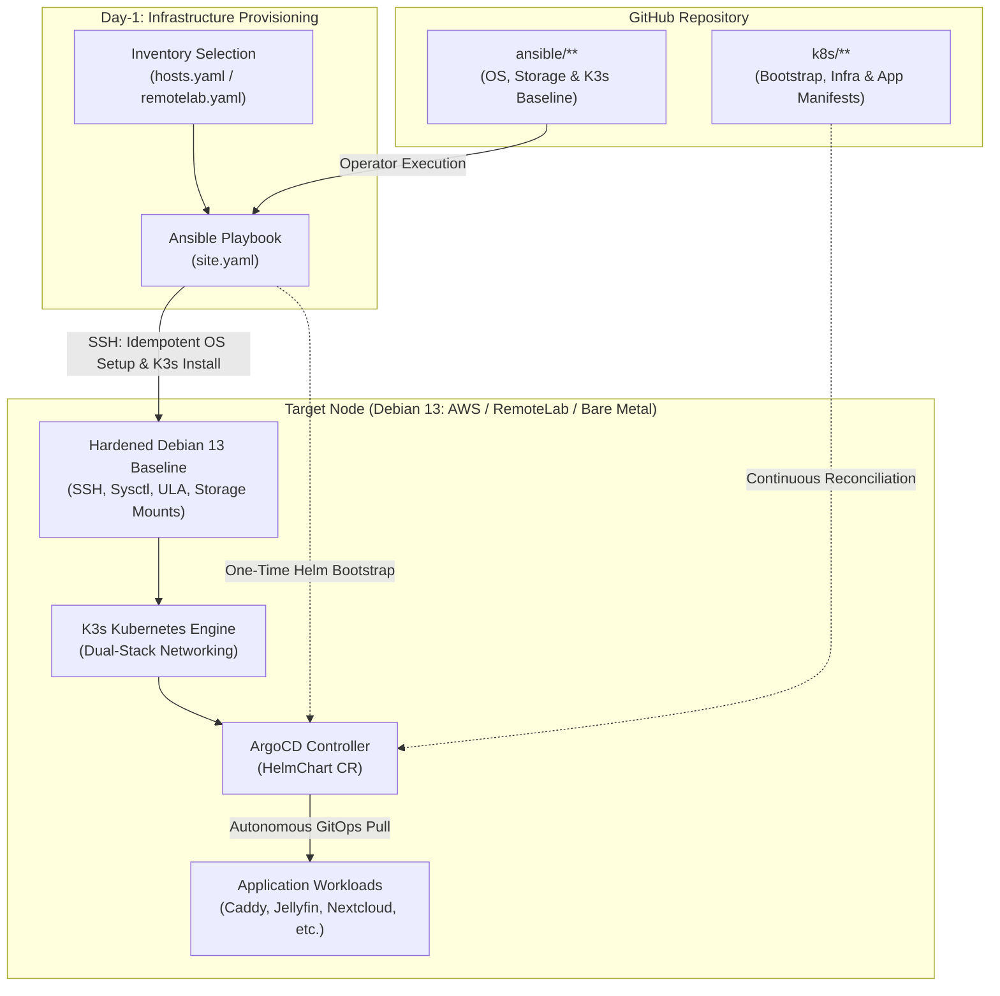

# Cloud-to-Bare-Metal: K3s Infrastructure & Homelab Migration

This repository contains the declarative infrastructure, configuration management, and GitOps workflows for migrating a legacy **Unraid homelab server** to a modern **K3s Kubernetes cluster** running on **Debian 13 (Trixie)**.

To minimize migration risk and maintain rollback capabilities, the architecture is developed and validated through a multi-stage pipeline:
1. **Cloud Testbed (AWS PoC):** Ephemeral infrastructure managed via Terraform and Ansible for automated cold-start verification.
2. **Local Staging (Hyper-V RemoteLab):** Validating real-world LAN networking, storage SCSI persistence, and ingress traffic without bare-metal hardware risk.
3. **Physical Target (Bare Metal):** Final deployment on dedicated hardware using 3-tier storage (`mergerfs` + `SnapRAID` bulk pool, NVMe appdata pool prepared for online mirror, and dedicated system SSD) and in-cluster ArgoCD GitOps.

---

## 🗺️ Migration Roadmap & Phases

The migration follows an 8-phase roadmap with explicit validation gates (Phase 4.5 & Phase 7.5):

| Phase | Milestone | Focus / Tech Stack | Status |
| :--- | :--- | :--- | :--- |
| **Phase 1** | **AWS PoC Infrastructure** | Ephemeral testbed via Terraform, EC2 (`t3.small`), encrypted EBS & dynamic SSH config | ✅ Done |
| **Phase 2** | **Ansible Baseline Setup** | Declarative OS hardening, base packages, ULA networking & PoC volume mounts | ✅ Done |
| **Phase 3** | **K3s Bootstrap & Runtime** | Dual-stack K3s installation, storage redirection, ArgoCD HelmChart CR & root app | 🏁 In Progress |
| **Phase 4** | **CI/CD & Code Quality** | Automated linting (`ansible-lint`, `terraform fmt`), dry-runs & clean rebuild testing | ⏳ Planned |
| **Phase 4.5** | **RemoteLab (Staging Environment)** | Hyper-V VM staging, SCSI WWID storage, Traefik Ingress routing & LAN validation | 🏁 In Progress |
| **Phase 5** | **Bare-Metal Foundation** | Physical hardware, system SSD, NVMe appdata pool, KVM hypervisor & DMZ ingress | ⏳ Planned |
| **Phase 6** | **GitOps Workload Migration** | App catalog (`k8s/infra`, `k8s/apps`), secrets operator & application workloads | ⏳ Planned |
| **Phase 7** | **Day-2 Operations & Security** | Automated SnapRAID timers, SQLite K3s state backup & restic PV backup | ⏳ Planned |
| **Phase 7.5** | **Pre-Migration Gate & Resilience** | App-by-app rehearsal, backup restore verification, SnapRAID recovery & rollback testing | ⏳ Planned |
| **Phase 8** | **Data Migration & Cutover** | In-place data array attachment, read-only mergerfs validation, appdata sync, SnapRAID parity cutover & DNS migration | ⏳ Planned |

---

## Architecture at a Glance

* **Infrastructure Provisioning (Phase 1 & 5):** Cloud testbeds provisioned with **Terraform** on AWS; bare-metal target initialized via Debian 13 on a dedicated system SSD.
* **OS Baseline & 3-Tier Storage (Phase 2 & 5):** Configured declaratively via **Ansible**:
  * **Tier 1 (System SSD):** Debian 13 host operating system and boot partition.
  * **Tier 2 (Appdata NVMe):** Dedicated NVMe storage (prepared for online mirror) for latency-sensitive K3s Persistent Volumes (`local-path-provisioner`) and write caching.
  * **Tier 3 (Bulk Storage Pool):** **In-place migration** of existing Unraid data HDDs (`mergerfs` pool with `SnapRAID` parity) without reformatting data disks.
* **Separation of Concerns (Day-1 vs. Day-2):**
  * **Day-1 Provisioning:** **Ansible** handles OS hardening, network configuration, storage mounts, K3s installation, and initial ArgoCD bootstrapping.
  * **Day-2 Workload Lifecycle:** **ArgoCD** runs natively inside the K3s cluster, using a **pull-based GitOps engine** to continuously reconcile manifests and Helm charts from Git.
* **Reboot Resilience & Idempotency:** Host and cluster configurations (IPv6 ULAs, storage mounts, kernel parameters) are designed for strict idempotency and reboot persistence, with formal verification gates scheduled in Phase 4.5 staging.

---

## Deployment Targets

The configuration management workflow targets the abstract OS layer (`Debian 13`), allowing identical roles to configure different environments via separate inventory files:

| Layer | AWS Cloud PoC (`eu-central-1`) | RemoteLab (Hyper-V Hypervisor) | Bare-Metal Target (Homelab) |
| :--- | :--- | :--- | :--- |
| **Purpose** | Fast IaC validation, ephemeral disaster recovery testbed | LAN staging, ingress validation, migration rehearsal | Production runtime environment |
| **Compute** | EC2 (`t3.small`, 2 GB RAM, low-cost) | Debian Gen2 VM (dedicated vCPUs, dynamic RAM) | Physical Intel node |
| **Storage** | AWS EBS (`gp3`, 10 GiB encrypted) | Virtual Hard Disk (SCSI WWID addressing) | **3-Tier Storage:**<br>1. System SSD (OS)<br>2. NVMe Pool (Appdata PVCs, prepared for mirror)<br>3. `mergerfs` + `SnapRAID` pool |
| **Inventory** | `ansible/inventory/hosts.yaml` | `ansible/inventory/remotelab.yaml` | `ansible/inventory/production.yaml` *(planned)* |
| **Cost Profile** | Pay-as-you-go (~0.10–0.20 € per 2–4 h test cycle) | Zero marginal cost | Fixed hardware / self-hosted |

---

## GitOps & Workflow Architecture (Day-1 vs. Day-2)

The architecture decouples **host & cluster bootstrapping (Day-1)** from **workload management (Day-2)**:



### 1. Day-1 Bootstrapping vs. Day-2 GitOps
* **Day-1 (Ansible):** Enforces desired host state: OS baseline packages, security hardening (SSH, kernel sysctl, module blacklisting), storage mounting via persistent device IDs, K3s installation, and bootstrapping ArgoCD.
* **Day-2 (ArgoCD):** Runs inside K3s. It monitors the `k8s/**` directory in Git and reconciles application workloads against the cluster API. External tools do not require direct Kubernetes API access or stored cluster credentials.

### 2. CI/CD & Security Boundary
* **Current State (Operator-Triggered):** Infrastructure orchestration is executed locally via Ansible CLI using 1Password SSH-Agent authentication (`SSH_AUTH_SOCK`).
* **Planned CI/CD (Phase 4):** GitHub Actions will automate linting (`ansible-lint`, `terraform fmt`) and dry-run syntax checks.
* **Public Repository Safety:** Because this repository is public, automated runners are deliberately not granted direct SSH or LAN access into the home network, avoiding security risks from fork PRs or untrusted workflow execution.
* **Secrets Management:** Infrastructure secrets stay outside Git (local 1Password). In-cluster Kubernetes secrets will be managed declaratively starting in Phase 6 (e.g. via External Secrets Operator or SOPS).

---

## Repository Structure

```text
.
├── README.md               # Project overview, roadmap and architecture blueprint
├── docs/                   # Technical documentation and guides
│   ├── adr/                # Architecture Decision Records (ADRs)
│   ├── reviews/            # Architecture & code reviews
│   ├── roadmap.md          # Project roadmap & implementation checklist
│   ├── terraform.md        # AWS PoC provisioning and lifecycle guide
│   └── ansible.md          # OS hardening, storage orchestration & K3s dual-stack guide
├── terraform/
│   └── aws-poc/            # AWS PoC IaC definitions (VPC, EC2, EBS, Security Groups)
├── ansible/                # Ansible configuration management
│   ├── requirements.yaml   # External collection dependencies (ansible.posix, community.general, ansible.utils)
│   ├── site.yaml           # Root orchestration playbook
│   ├── inventory/          # Target inventories (AWS hosts.yaml, RemoteLab remotelab.yaml)
│   └── roles/              # Modular roles (os_base, storage_poc, k3s_install)
└── k8s/                    # Kubernetes GitOps manifests
    ├── bootstrap/          # ArgoCD root application (root-app.yaml)
    └── test-workload/      # Smoke-test workload manifests (Caddy test workload)
```

---

## Detailed Documentation

* [Project Roadmap & Implementation Checklist](docs/roadmap.md)
* [Architecture & Code Reviews](docs/reviews/review-1.md)
* [Architecture Decision Records (ADRs)](docs/adr/README.md)
* [Terraform AWS Provisioning & Lifecycle Guide](docs/terraform.md)
* [Ansible Configuration & K3s Provisioning Guide](docs/ansible.md)

---

## Quickstart

### Prerequisites

* AWS CLI configured (profile `[homelab]` by default)
* Terraform >= 1.5.0
* Ansible >= 2.15.0
* Dedicated SSH key pair (default: `~/.ssh/id_ed25519_aws_homelab.pub`)

### 1. Provision AWS PoC (Phase 1)

```bash
cd terraform/aws-poc
terraform init
terraform apply
```

### 2. Connect to the Node

```bash
ssh -F ssh_config aws-k3s-poc
```

### 3. Provision Baseline & K3s Cluster (Phase 2 & 3)

```bash
cd ../../ansible

# Install collection dependencies
ansible-galaxy collection install -r requirements.yaml

# Execute playbook against the generated AWS inventory
ansible-playbook -i inventory/hosts.yaml site.yaml
```

### 4. Teardown AWS Resources

When finished testing, teardown cloud infrastructure to eliminate costs:

```bash
cd ../terraform/aws-poc
terraform destroy
```

### 5. Deploy to RemoteLab Staging (Phase 4.5)

To target the local Hyper-V staging environment, execute the same playbook against the RemoteLab inventory.

> [!NOTE]
> The initial run against a freshly installed Debian target requires `-K` (`--ask-become-pass`) to configure passwordless sudo (`/etc/sudoers.d/10-ansible`). Subsequent runs execute unattended without additional flags.

```bash
cd ../../ansible
ansible-playbook -i inventory/remotelab.yaml site.yaml -K
```

---

## License

Distributed under the [MIT License](LICENSE).