# ADR-0006: Dual-Track Update and Lifecycle Strategy (Continuous GitOps Apps vs. Ephemeral Cloud-Staged Platform Upgrades)

* **Status:** Accepted
* **Date:** 2026-10-16

## Context

The homelab infrastructure comprises two fundamentally distinct operational layers:
1. **Application Workloads (Day-2):** Over 30 containerized microservices and stateful applications (e.g., Nextcloud, Paperless-ngx, Jellyfin, Vaultwarden, AdGuard Home).
2. **Core Platform & Infrastructure Layer (Day-1):** The Debian host OS, Linux kernel, storage subsystems (mergerfs/SnapRAID), K3s Kubernetes runtime, Flannel CNI, and the ArgoCD GitOps controller.

In traditional homelab environments (such as Unraid with Community Applications), container updates are routinely performed via GUI "Update All" actions with floating tags (`:latest`). While convenient, this practice lacks auditability, eliminates deterministic rollbacks, and risks silent data corruption or breaking changes during daytime operations.

Conversely, maintaining a permanent, identically sized on-premise staging cluster 24/7 is cost-prohibitive in hardware, power consumption, and administrative overhead—especially as access to dedicated local test virtualization (RemoteLab) is temporary.

We require an operational update strategy that balances rapid application iteration with enterprise-grade stability and disaster recovery for core infrastructure components.

## Decision

We adopt a **Dual-Track Update and Lifecycle Strategy**:

```mermaid
flowchart TD
    subgraph Track1 ["Track 1: Application Workloads (Continuous GitOps)"]
        Dev["Git Commit / PR<br/>(Renovate Bot)"]
        Git["Git Repository (Single Source of Truth)"]
        Argo["ArgoCD Controller<br/>(Continuous Reconciliation)"]
        ProdApps["Production Workloads<br/>(Immediate Rolling Updates)"]
        Revert["Instant Rollback via 'git revert'"]

        Dev --> Git --> Argo --> ProdApps
        ProdApps -.->|On Failure| Revert --> Git
    end

    subgraph Track2 ["Track 2: Platform & Core Upgrades (Infrequent, Cloud-Staged)"]
        InfraUp["OS / K3s / ArgoCD Upgrade<br/>(1-3x per Year)"]
        TF["Terraform Apply<br/>(Ephemeral AWS Staging Clone)"]
        Ans["Ansible Baseline & Bootstrap"]
        Test["E2E Validation & Health Check<br/>(2-4h Runtime, < $2.00)"]
        Destroy["Terraform Destroy<br/>(Immediate Teardown)"]
        ProdInfra["Production Bare-Metal Apply"]

        InfraUp --> TF --> Ans --> Test --> Destroy
        Test -->|Validated| ProdInfra
    end
```

### 1. Track 1: Continuous GitOps for Application Workloads
* **Strict Tag Pinning:** Container images must never utilize `:latest` or unpinned floating tags. All application versions are explicitly pinned in Git.
* **Automated Dependency Auditing:** Automated tools (such as **Renovate**) periodically audit dependencies and submit Pull Requests with comprehensive release notes.
  * *Patch Updates:* Eligible for automated merging and deployment.
  * *Minor/Major Updates:* Require administrative approval after reviewing changelogs.
* **Instant Rollback Guarantee:** In the event of an application regression, executing `git revert <commit-hash>` restores the previous known-good state within seconds via ArgoCD. Minor, temporary application downtime is acceptable in a homelab context.

### 2. Track 2: Ephemerally Staged Cloud Validations for Infrastructure Upgrades
* **Low Update Frequency:** Core platform components (Kubernetes minor releases, ArgoCD chart updates, Debian OS upgrades) are upgraded infrequently (1–3 times per year) and never applied directly to production untested.
* **Ephemeral AWS Validation Clone:**
  * Prior to a production platform upgrade, Terraform provisions an on-demand, disposable staging instance on AWS.
  * Ansible applies the updated baseline configuration and bootstraps K3s and ArgoCD.
  * ArgoCD synchronizes the application catalog to validate Kubernetes API schema deprecations, CRD migrations, and startup behavior (without mounting multi-terabyte production data arrays).
  * After completing validation (typically 1–2 hours), the staging instance is immediately torn down via `terraform destroy`.
* **Cost & Safety Controls:**
  * Ephemeral runtime keeps cloud costs negligible (fractions of a euro per upgrade cycle).
  * Automated AWS Budget Alarms guard against forgotten lingering instances.
* **Disaster Recovery Side-Benefit:** Successfully deploying the complete application stack on an ephemeral cloud node continuously validates cold-start reproducibility and disaster recovery readiness.

## Consequences

**Positive:**
* **Risk Decoupling:** Routine application updates proceed with high agility, while high-risk infrastructure migrations are thoroughly de-risked before touching bare metal.
* **Disaster Recovery Verification:** The ephemeral staging pipeline serves as a recurring, automated test of whether the entire homelab can be reconstructed from scratch purely from Git.
* **Minimal Financial Overhead:** Zero hardware acquisition costs for a dedicated physical staging lab; cloud testing costs are limited to small change (< 5 € per year).
* **Deterministic Audit Trail:** Every single change—whether an app image bump or a K3s release—is codified in Git history.

**Negative & Trade-offs:**
* **Discipline Required:** Requires strict adherence to tearing down cloud staging resources via `terraform destroy`.
* **Hardware Parity Limitations:** AWS virtualized instances cannot model bare-metal specific hardware interactions (e.g., physical SAS/SATA controller behavior or local motherboard sensors). Hardware-specific quirks must be validated during production application.

## Alternatives Considered

* **Permanent On-Premise Staging Host:**
  * *Rejected:* Unjustified hardware, electricity, and maintenance costs for a single-node homelab environment.
* **Direct In-Place Production Upgrades:**
  * *Rejected:* High risk of cluster-bricking failures during Kubernetes minor upgrades or CNI network changes, requiring difficult offline remediation.
* **Unraid-Style Automatic `:latest` Updates:**
  * *Rejected:* Violates core GitOps principles, introduces non-deterministic drift, and eliminates rapid auditability and rollback mechanisms.
