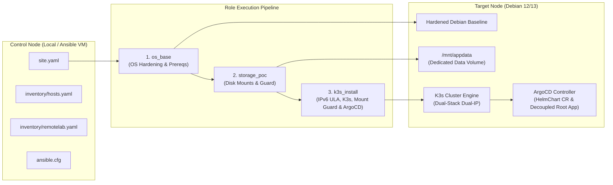

# Ansible Infrastructure & K3s Provisioning Documentation

This document describes the configuration management, OS hardening, storage provisioning, networking topology, and cluster bootstrapping implemented via **Ansible** (`ansible/`) for the K3s Homelab Migration project.

---

## 1. Orchestration Architecture & Workflow

The Ansible setup automates the **Day-1 provisioning** of target nodes, preparing a Debian system (tested on Debian 12/13) to serve as a dual-stack K3s Kubernetes host with an autonomous GitOps engine.



### Configuration & Inventory Structure

* **`ansible.cfg`:**
  * `inventory = ./inventory/hosts.yaml`: Default inventory location.
  * `roles_path = ./roles`: Modular role directory.
  * `host_key_checking = False`: Prevents interactive SSH host-key prompts on freshly provisioned disposable instances.
  * `stdout_callback = debug`: Human-readable console output.
  * `pipelining = True`: Reuses SSH connections and executes Python tasks in memory to reduce network latency.
* **Inventories:**
  * **`inventory/hosts.yaml` (AWS Cloud PoC):** Routes SSH traffic via the dynamically generated OpenSSH configuration from Terraform (`ansible_ssh_common_args: '-F ../terraform/aws-poc/ssh_config'`). Defines `data_disk_device` using the persistent udev path `/dev/disk/by-id/nvme-Amazon_Elastic_Block_Store_<vol_id>` exported by Terraform.
  * **`inventory/remotelab.yaml` (RemoteLab Test VM):** Targets the local test node (`10.100.34.71`) as user `alex`, specifying a persistent SCSI WWID path (`/dev/disk/by-id/scsi-...`) for the storage disk.
* **`site.yaml`:**
  * Root playbook applying the roles sequentially with elevated privileges (`become: true`):
    1. `os_base`
    2. `storage_poc`
    3. `k3s_install`

---

## 2. OS Baseline & Security Hardening (`roles/os_base`)

The `os_base` role establishes baseline hygiene, installs container storage prerequisites, and implements a security baseline tailored for Kubernetes host nodes.

### Package Management & Maintenance Updates
* **Base Packages:** Installs `curl`, `git`, `htop`, `jq`, `open-iscsi`, `nfs-common` (required for K8s CSI persistent storage mounts), `systemd-timesyncd`, `unattended-upgrades`, and `apt-listchanges`.
* **Automated Security Updates (`unattended-upgrades`):**
  * Configured via `/etc/apt/apt.conf.d/50unattended-upgrades` to restrict automatic updates to security patches (`label=Debian-Security`).
  * Kernel images and headers (`linux-image*`, `linux-headers*`) are blacklisted from automatic uncoordinated updates.
  * Configured with automatic reboot window scheduled at `03:00` (`Unattended-Upgrade::Automatic-Reboot "true"`).
  * Update schedules configured via `/etc/apt/apt.conf.d/20auto-upgrades`.
  * Verified active via systemd timers (`apt-daily.timer`, `apt-daily-upgrade.timer`).

### Persistent IPv6 ULA Configuration (ADR-0001)
* Deploys a persistent network configuration to `/etc/network/interfaces.d/60-ula.cfg` binding a static RFC 4193 ULA (`fd85:cc6d:b16f:30::10/64`) to the default interface.
* Applies the address non-destructively at runtime via `ip -6 addr replace` if not already present.
* Refreshes Ansible facts immediately after assignment.

### OpenSSH Daemon Hardening
* Deployed as a modular drop-in file at `/etc/ssh/sshd_config.d/00-hardening.conf`.
* **First-Match-Wins Precedence:** Uses the `00-` prefix to ensure rules evaluate before default Debian settings or cloud-init snippets.
* **Authentication Controls:**
  * `PermitRootLogin no`: Direct root logins are prohibited.
  * `PasswordAuthentication no` & `KbdInteractiveAuthentication no`: Password authentication is disabled; key-based authentication (`PubkeyAuthentication yes`) is required.
  * `AllowUsers {{ ansible_user }}`: Dynamically restricts SSH access to the configured Ansible administrator user.
* **Brute-Force & DoS Mitigation:**
  * `MaxAuthTries 3`: Terminates sessions after three failed attempts.
  * `LoginGraceTime 30`: Drops unauthenticated connection attempts after 30 seconds to prevent connection exhaustion.
* **Session Hygiene & Attack Surface:**
  * `ClientAliveInterval 300` and `ClientAliveCountMax 2`: Terminates stale/orphaned sessions after 10 minutes of inactivity.
  * `X11Forwarding no` and `AllowAgentForwarding no`: Prevents graphical forwarding and agent socket hijacking on the remote server.
* **Safety Guard:** Validated before writing via `validate: '/usr/sbin/sshd -t -f %s'`. Triggers a reactive `restart ssh` handler on change.

### Kernel Sysctl Hardening & Tuning
* Maintained as a dedicated file at `roles/os_base/files/99-kubernetes-hardening.conf` and deployed via `ansible.builtin.copy` to `/etc/sysctl.d/99-kubernetes-hardening.conf`. Reloaded reactively via `sysctl --system`.
* **Anti-Spoofing & Network Protection (Kubernetes-Compatible):**
  * `net.ipv4.conf.all.rp_filter = 2` and `net.ipv4.conf.default.rp_filter = 2`: **Loose-Mode Reverse Path Filtering (ADR-0005)**. Avoids the common Kubernetes failure where strict filtering (`1`) silently drops asymmetric container/Flannel CNI traffic.
  * Disables ICMP redirects (`accept_redirects = 0`, `send_redirects = 0`) and IP source routing (`accept_source_route = 0`).
  * Enables TCP SYN cookies (`net.ipv4.tcp_syncookies = 1`).
* **Routing Requirements:**
  * Enforces `net.ipv4.ip_forward = 1` and `net.ipv6.conf.all.forwarding = 1` required for pod overlay and ULA communication.
* **Kernel & Memory Protection:**
  * `kernel.dmesg_restrict = 1`: Blocks unprivileged users and containers from reading kernel log buffers.
  * `kernel.kptr_restrict = 2`: Hides kernel pointer addresses in `/proc`.
  * `kernel.sysrq = 0`: Disables Magic SysRq keys to prevent console dump/reboot abuse.
  * `fs.suid_dumpable = 0`: Disables coredumps for SUID binaries.
  * Enforces protected hardlinks and symlinks (`fs.protected_hardlinks = 1`, `fs.protected_symlinks = 1`).
* **Container Workload Limits:**
  * Increases inotify limits (`fs.inotify.max_user_watches = 524288`, `fs.inotify.max_user_instances = 8192`) to prevent container crashes in file-monitoring tools (e.g., Prometheus, ArgoCD).

### Journald Log Volume Limits (K8s DiskPressure Mitigation)
* Deployed to `/etc/systemd/journald.conf.d/00-limits.conf`.
* Caps systemd journal log footprint at `SystemMaxUse=1G`, `SystemMaxFileSize=100M`, and `MaxRetentionSec=1month`.
* Disables duplicate syslog forwarding (`ForwardToSyslog=no`).
* Protects the root filesystem from being exhausted by container logs, preventing Kubernetes `DiskPressure` node taints and pod evictions. Triggers handler `restart systemd-journald`.

### Kernel Module Blacklisting
* Maintained as a dedicated file at `roles/os_base/files/99-hardening-blacklist.conf` and deployed via `ansible.builtin.copy` to `/etc/modprobe.d/99-hardening-blacklist.conf`.
* Uses `install <module> /bin/true` stubs to block auto-loading of vulnerable or obsolete subsystems:
  * **Uncommon Network Protocols:** `dccp`, `rds`, `tipc`.
  * **Obsolete Filesystems:** `cramfs`, `freevxfs`, `jffs2`, `hfs`, `hfsplus`, `udf`.

### NTP Time Synchronization
* Ensures `systemd-timesyncd` is installed, enabled, and active.
* Prevents clock drift to protect TLS certificate validation and Kubernetes ServiceAccount/JWT token expiration.

### Sudoers Security
* Deploys `/etc/sudoers.d/00-hardening` with permissions `0440`, validated via `/usr/sbin/visudo -cf %s`.
* Configures `Defaults use_pty` (protects against terminal hijacking via `TIOCSTI` ioctl injection) and `Defaults logfile="/var/log/sudo.log"` for administrative auditability.

---

## 3. Storage Provisioning (`roles/storage_poc`)

The `storage_poc` role prepares dedicated storage for Kubernetes persistent volumes by creating and mounting a data volume at `/mnt/appdata`.

### Current Implementation
1. **Pre-Flight Assertion (`ansible.builtin.assert`):**
   * Verifies that `data_disk_device` is defined and non-empty. Fails fast with an actionable message if an inventory omits the device variable, preventing accidental operations on unconfigured targets.
2. **Filesystem Creation (`community.general.filesystem`):**
   * Inspects `{{ data_disk_device }}`. If an `ext4` filesystem already exists, the task is idempotent (`changed: false`). If raw, formats the device with `ext4`.
3. **Mount Point Provisioning (`ansible.builtin.file`):**
   * Ensures `/mnt/appdata` exists with permissions `0755`.
4. **Persistent Mounting (`ansible.posix.mount`):**
   * Mounts `{{ data_disk_device }}` to `/mnt/appdata` and registers the entry in `/etc/fstab` with `opts: defaults,nofail` and `state: mounted`.
   * The `nofail` option ensures the node boots into multi-user mode instead of an unreachable emergency shell if the storage volume is temporarily detached.

### Device Addressing in Inventories
Target hosts must reference stable device identifiers rather than ephemeral kernel names (`/dev/sdb` or `/dev/nvme1n1`) to survive controller reordering:
* **AWS Cloud PoC (Nitro NVMe):** Uses the udev path `/dev/disk/by-id/nvme-Amazon_Elastic_Block_Store_<vol_id>` exported by Terraform (`data_disk_device`). This avoids NVMe controller enumeration flipping across instance reboots.
* **RemoteLab / Bare Metal:** Uses persistent SCSI WWID symlinks (`/dev/disk/by-id/scsi-...`) or filesystem UUIDs.

### Planned Evolution (Phase 5 Bare-Metal Migration)
In Phase 5, formatting tasks will be eliminated:
* Existing Unraid data drives will be mounted by filesystem UUID (`/dev/disk/by-uuid/...`).
* Storage pooling will be handled via `mergerfs` (JBOD pool) and `SnapRAID` (parity protection).
* Dedicated NVMe SSD mirrors will be mounted at `/mnt/appdata` for persistent application workloads.

---

## 4. K3s Dual-Stack Networking (`roles/k3s_install`)

The `k3s_install` role configures and bootstraps K3s with native dual-stack networking according to ADR-0001.

### 1. ADR-0001 ULA Verification
Before configuring K3s, the role asserts that the host has a valid IPv6 ULA from the `fd85:cc6d:b16f:30::/64` prefix assigned to its primary interface.

### 2. Root-Disk Overflow Guard
Before writing K3s configuration or starting the cluster, the role refreshes mount facts (`ansible.builtin.setup` with `gather_subset: ['!all', 'mounts']`) and verifies that `/mnt/appdata` is actively mounted in `ansible_facts['mounts']`. If the dedicated storage device failed to mount, execution terminates immediately. This prevents K3s's built-in `local-path-provisioner` from silently allocating persistent volumes on the host's root partition.

### 3. Declarative Configuration (`/etc/rancher/k3s/config.yaml`)
Node parameters are declared centrally in `/etc/rancher/k3s/config.yaml` before the installation script runs:

```yaml
# Dual-Stack: IPv4 (10.42.x.x) / IPv6 ULAs (fd85:cc6d:b16f::) according to ADR-0001
cluster-cidr: "10.42.0.0/16,fd85:cc6d:b16f:4200::/56"
service-cidr: "10.43.0.0/16,fd85:cc6d:b16f:4300::/112"
flannel-ipv6-masq: true

# Force the node to use both IPs (dynamic IPv4 + static ULA)
node-ip: "{{ ansible_facts['default_ipv4']['address'] }},{{ ansible_facts['all_ipv6_addresses'] | select('match', '^fd85:cc6d:b16f:30::') | first }}"

# Storage: Dedicated path for Persistent Volumes
default-local-storage-path: "/mnt/appdata"
```

* **Storage Redirection (`default-local-storage-path`):** Redirects K3s's built-in `local-path-provisioner` from `/var/lib/rancher/k3s/storage` on the root disk to `/mnt/appdata`.
* **Flannel IPv6 Masquerading (`flannel-ipv6-masq: true`):** Masquerades pod outbound IPv6 traffic behind the host's ULA address.

---

## 5. GitOps Bootstrap Engine (`roles/k3s_install`)

The role bootstraps the ArgoCD GitOps engine using a dual-track strategy (ADR-0006) to decouple controller installation from application delivery:

1. **Manifest Directory Provisioning:** Creates `/var/lib/rancher/k3s/server/manifests` with permissions `0700` (`root:root`) as recommended hardening for K3s's internal directory.
2. **Declarative ArgoCD HelmChart (`argocd.yaml`):** Deploys a K3s `HelmChart` custom resource into the auto-deploy directory:
   * Chart version is pinned (`7.7.16` in `roles/k3s_install/defaults/main.yaml`) from repository `https://argoproj.github.io/argo-helm`.
   * Automatically creates and manages the `argocd` namespace (`targetNamespace: argocd`, `createNamespace: true`).
3. **K3s Service Activation:** Executes `/tmp/k3s-install.sh` (`creates: /usr/local/bin/k3s`) and enables `k3s.service`.
4. **CRD Establishment Wait:** Polls until the `applications.argoproj.io` Custom Resource Definition is established (`rc == 0`), ensuring the ArgoCD API is responsive before submitting workloads.
5. **Decoupled App-of-Apps Root Application:** Deploys `k8s/bootstrap/root-app.yaml` via `k3s kubectl apply`.
   * **Dual-Reconciler Prevention (ADR-0006):** Placed outside K3s's auto-deploy directory so that only ArgoCD reconciles application manifests without competing against K3s's filesystem watcher.

---

## 6. Execution Guide & Verification

### Running the Playbook

```bash
# 1. Syntax check
ansible-playbook -i inventory/remotelab.yaml site.yaml --syntax-check

# 2. Dry run / Check mode
ansible-playbook -i inventory/remotelab.yaml site.yaml --check

# 3. Apply infrastructure state
ansible-playbook -i inventory/remotelab.yaml site.yaml
```

### Post-Deployment Verification Checklist

After applying the playbook or performing a cold reboot, verify system integrity on the target node:

```bash
# 1. Verify storage mount persistence
findmnt /mnt/appdata

# 2. Verify kernel hardening parameters
sysctl kernel.dmesg_restrict kernel.sysrq net.ipv4.conf.all.rp_filter

# 3. Verify active systemd timers & time synchronization
systemctl is-active systemd-timesyncd apt-daily.timer apt-daily-upgrade.timer

# 4. Verify modprobe stub execution
sudo modprobe -n -v dccp
# Expected output: install /bin/true

# 5. Verify journald disk usage limit
journalctl --disk-usage

# 6. Verify K3s node and pod status
sudo k3s kubectl get nodes -o wide
sudo k3s kubectl get pods -A
```
