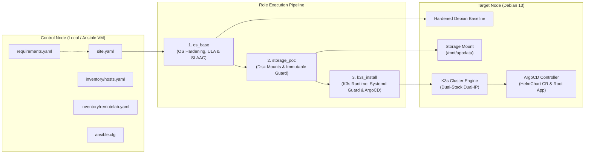

# Ansible Infrastructure & K3s Provisioning Documentation

This document describes the configuration management, OS hardening, storage provisioning, networking topology, and cluster bootstrapping implemented via **Ansible** (`ansible/`) for the K3s Homelab Migration project.

---

## 1. Orchestration Architecture & Workflow

The Ansible setup automates the **Day-1 provisioning** of target nodes, preparing a Debian 13 (Trixie) system to serve as a dual-stack K3s Kubernetes host with an autonomous GitOps engine.



### Configuration & Inventory Structure

* **`requirements.yaml`:**
  * Declares external collection dependencies (`ansible.posix`, `community.general`, `ansible.utils`) installed via `ansible-galaxy collection install -r requirements.yaml`.
* **`ansible.cfg`:**
  * `inventory = ./inventory/hosts.yaml`: Default inventory location.
  * `roles_path = ./roles`: Modular role directory.
  * `stdout_callback = debug`: Human-readable console output.
  * `pipelining = True`: Executes Python tasks directly via `stdin` on the target node instead of transferring temporary files per task, reducing round-trip latency.
  * *Host Key Verification (Review 2 R2-7):* Global `host_key_checking = False` is deliberately omitted. Persistent nodes (RemoteLab & Bare Metal) rely on standard SSH host-key validation via `~/.ssh/known_hosts`, preventing LAN MitM attacks. Ephemeral disposable nodes (AWS Cloud PoC) configure `StrictHostKeyChecking no` scoped exclusively via their dedicated `ssh_config`.
* **Inventories & Group Variables:**
  * **`inventory/group_vars/all.yaml`:** Central repository for cross-cutting parameters (`node_ipv6_ula`, `node_ipv4`, `appdata_path`), decoupling roles and preventing duplicated default values.
  * **`inventory/hosts.yaml` (AWS Cloud PoC, gitignored):** Dynamically generated during `terraform apply` (templated from `inventory/hosts.yaml.example`). Routes SSH traffic via the absolute path of the generated OpenSSH configuration (`ansible_ssh_common_args: '-F <abspath>/ssh_config'`). Defines `data_disk_device` using persistent udev path `/dev/disk/by-id/nvme-Amazon_Elastic_Block_Store_<vol_id>` and pins `node_ipv4` to the instance's private IP.
  * **`inventory/hosts.yaml.example`:** Committed template demonstrating structure and variables for AWS cloud deployments.
  * **`inventory/remotelab.yaml` (RemoteLab Test VM):** Targets the local test node (`10.100.34.71`) as user `alex`, pinning `node_ipv4: 10.100.34.71` (avoiding DHCP drift) and specifying persistent SCSI WWID path (`/dev/disk/by-id/scsi-...`) for the storage disk.
* **Role Variable Architecture:**
  * Every role defines its parameters centrally in `roles/<role_name>/defaults/main.yaml`.
  * Values can be cleanly overridden per environment via inventory `group_vars/` or `host_vars/` without editing task files.
* **`site.yaml`:**
  * Root playbook applying the roles sequentially with elevated privileges (`become: true`):
    1. `os_base`
    2. `storage_poc`
    3. `k3s_install`

---

## 2. OS Baseline & Security Hardening (`roles/os_base`)

The `os_base` role establishes baseline hygiene, installs container storage prerequisites, and implements a security baseline tailored for Kubernetes host nodes.

### Package Management & Maintenance Updates

* **Base Packages (`os_base_packages`):** Default list installs `curl`, `git`, `htop`, `jq`, `open-iscsi`, `unattended-upgrades`, `apt-listchanges`, `systemd-timesyncd`, and `nfs-common` (required for K8s CSI persistent storage mounts).
* **Automated Security Updates (`unattended-upgrades` - ADR-0004):**
  * Configured via `/etc/apt/apt.conf.d/50unattended-upgrades` to restrict automatic updates to security patches (`label=Debian-Security`).
  * Kernel security updates (`linux-image*`, `linux-headers*`) are permitted (Review 2 R2-8) as no out-of-tree DKMS modules (e.g., ZFS) are used; required in-tree drivers remain intact and container escape CVEs are patched without delay.
  * Configured with automatic reboot window scheduled via `os_reboot_time` (default: `"03:00"`).
  * Update schedules configured via `os_auto_clean_days` (default: `"7"`). Download bandwidth throttled via `os_download_limit` (default: `"0"`, unlimited).
  * Verified active via systemd timers (`apt-daily.timer`, `apt-daily-upgrade.timer`).

### Persistent IPv6 ULA & SLAAC Configuration (ADR-0001)

* **Interface-Based Network Framework Detection (Review 2 R2-5):**
  * Determines which stack manages the primary interface (`ansible_facts['default_ipv4']['interface']`): `ifquery --state` for classic `ifupdown`, `networkctl` setup state `configured` for `systemd-networkd` (generated by `netplan`).
  * Service state alone is not sufficient: `networking.service` is a oneshot unit and reports `active (exited)`, never `running`.
  * Fails fast via `assert` with a dedicated message if no stack, both stacks, or `systemd-networkd` without `netplan` manage the interface, preventing dual or ineffective configuration writes. The queries are read-only and also run in check mode.
  * Writes persistent configuration for `node_ipv6_ula` (default: `"fd85:cc6d:b16f:30::10/64"`):
    * Debian ISO / RemoteLab (`ifupdown`): `/etc/network/interfaces.d/60-ula.cfg` with static ULA, `accept_ra 2` and `autoconf 1`.
    * Cloud AMIs / Netplan: `/etc/netplan/60-ula.yaml` with static ULA and `accept-ra: true`.
* **Runtime Activation & SLAAC Persistence (Review 2 R2-4):**
  * Checks `ansible_facts['all_ipv6_addresses']` and applies the ULA via `ip -6 addr replace` if not present.
  * Deploys `/etc/sysctl.d/60-accept-ra.conf` enforcing `net.ipv6.conf.<iface>.accept_ra = 2` dynamically at runtime, ensuring the kernel continues accepting Router Advertisements and renewing SLAAC GUAs and default routes even when packet forwarding is enabled.
  * Refreshes Ansible network facts immediately after assignment.

### OpenSSH Daemon Hardening

* Deployed as a modular drop-in file at `/etc/ssh/sshd_config.d/00-hardening.conf` (mode `0644`, syntax-validated via `sshd -t -f %s`).
* **First-Match-Wins Precedence:** Uses the `00-` prefix to ensure rules evaluate before default settings.
* **Authentication Controls:**
  * `PermitRootLogin no`: Direct root logins prohibited.
  * `PasswordAuthentication no` & `KbdInteractiveAuthentication no`: Enforces key-based authentication (`PubkeyAuthentication yes`).
  * `AllowUsers {{ ansible_user }}`: Restricts SSH access to the configured administrative user.
* **Brute-Force & DoS Mitigation:**
  * `MaxAuthTries 3`: Terminates sessions after three failed attempts.
  * `LoginGraceTime 30`: Drops unauthenticated connections after 30 seconds.
* **Session Hygiene:**
  * `ClientAliveInterval 300` and `ClientAliveCountMax 2`: Terminates orphaned sessions after 10 minutes of inactivity.
  * `X11Forwarding no` and `AllowAgentForwarding no`: Prevents graphical forwarding and agent socket hijacking.
* Triggers handler `restart ssh` on changes.

### Kernel Sysctl Hardening & Tuning

* Maintained at `roles/os_base/files/99-kubernetes-hardening.conf` and copied to `/etc/sysctl.d/99-kubernetes-hardening.conf`. Reloaded via handler `sysctl --system`.
* **Anti-Spoofing & Network Protection (Kubernetes-Compatible):**
  * `net.ipv4.conf.all.rp_filter = 2` and `net.ipv4.conf.default.rp_filter = 2`: **Loose-Mode Reverse Path Filtering (ADR-0005)**. Prevents silent dropping of asymmetric container/Flannel CNI traffic.
  * Disables ICMP redirects (`accept_redirects = 0`, `send_redirects = 0`) and IP source routing (`accept_source_route = 0`).
  * Enables TCP SYN cookies (`net.ipv4.tcp_syncookies = 1`).
* **Routing Requirements & Forwarding Baseline:**
  * Enforces `net.ipv4.ip_forward = 1` and `net.ipv6.conf.all.forwarding = 1` required for pod overlay and container routing.
  * Sets `net.ipv6.conf.all.accept_ra = 2` and `net.ipv6.conf.default.accept_ra = 2` as baseline to ensure newly created network interfaces inherit router advertisement reception under forwarding.
* **Kernel & Memory Protection:**
  * Restricts dmesg access (`kernel.dmesg_restrict = 1`), hides pointer addresses (`kernel.kptr_restrict = 2`), disables SysRq (`kernel.sysrq = 0`), enforces core dump safety (`fs.suid_dumpable = 0`), and protects hardlinks/symlinks (`fs.protected_hardlinks = 1`, `fs.protected_symlinks = 1`).
* **Container Workload Limits:**
  * Increases inotify limits (`fs.inotify.max_user_watches = 524288`, `fs.inotify.max_user_instances = 8192`) to prevent container crashes in file-monitoring tools.

### Journald Log Volume Limits

* Deployed to `/etc/systemd/journald.conf.d/00-limits.conf`.
* Configurable via role defaults: `os_systemd_max_usage: "1G"`, `os_systemd_max_file_size: "100M"`, `os_systemd_max_retention_sec: "1month"`.
* Prevents the host root filesystem from filling with logs, mitigating Kubernetes `DiskPressure` node taints and pod evictions. Triggers handler `restart systemd-journald`.

### Kernel Module Blacklisting

* Maintained at `roles/os_base/files/99-hardening-blacklist.conf` and copied to `/etc/modprobe.d/99-hardening-blacklist.conf`.
* Stubs out vulnerable or obsolete subsystems (`install <module> /bin/true`):
  * **Uncommon Network Protocols:** `dccp`, `rds`, `tipc`.
  * **Obsolete Filesystems:** `cramfs`, `freevxfs`, `jffs2`, `hfs`, `hfsplus`, `udf`.

### Sudoers Security & Non-Interactive Automation

* Deploys `/etc/sudoers.d/00-hardening` (`Defaults use_pty`, `Defaults logfile="/var/log/sudo.log"`).
* Deploys `/etc/sudoers.d/10-ansible` granting `{{ ansible_user }} ALL=(ALL) NOPASSWD: ALL` (mode `0440`, syntax-validated via `visudo -cf %s`), enabling non-interactive Ansible automation without plaintext passwords or interactive prompts.

---

## 3. Storage Provisioning (`roles/storage_poc`)

The `storage_poc` role prepares dedicated storage for Kubernetes persistent volumes by creating and mounting a data volume.

### Role Parameters (`defaults/main.yaml`)

* `storage_mount_point`: Destination directory on the host (default: `"{{ appdata_path | default('/mnt/appdata') }}"`).
* `storage_filesystem_type`: Target filesystem (default: `"ext4"`).
* `storage_volume_options`: Mount options (default: `"defaults,nofail"`).

### Implementation Workflow

1. **Pre-Flight Device Check (`assert`):**
   * Verifies that `data_disk_device` is defined in the active inventory, failing fast before performing disk operations.
2. **Filesystem Creation (`community.general.filesystem`):**
   * Idempotently formats `{{ data_disk_device }}` with `{{ storage_filesystem_type }}` if unformatted.
3. **Mount Point Provisioning (`file`):**
   * Ensures `{{ storage_mount_point }}` directory exists with permissions `0755`.
4. **Root-Disk Overflow Directory Guard (`file` / `attributes: +i` - Review 2 R2-1):**
   * Applies the immutable attribute (`chattr +i`) to the directory **underneath** `{{ storage_mount_point }}` on the root filesystem. If the storage volume is missing (boot without disk, lazy unmount), any write attempt to the path fails with `Operation not permitted`, even for root, preventing silent root filesystem pollution.
   * Works identically on fresh and already mounted nodes: the role bind-mounts the root filesystem without submounts (`mount --bind /`) to a temporary directory in `/run`, sets the flag on the hidden directory there, and always unmounts the view afterwards (`block`/`always`). Only setting the flag reports `changed`; the helper commands also run in check mode.
   * Assumes the parent directory of the mount point resides on the root filesystem.
5. **Persistent Mounting (`ansible.posix.mount`):**
   * Mounts the device to `{{ storage_mount_point }}` and registers the entry in `/etc/fstab` with `opts: "{{ storage_volume_options }}"`.
   * The `nofail` flag ensures the host boots successfully into multi-user mode even if the storage volume is temporarily detached.
   * `passno: 2` runs `fsck` before mounting. If the filesystem cannot be repaired automatically, the mount unit stays down and K3s does not start (`RequiresMountsFor=`), while the host remains reachable via SSH.
   * Once mounted, the underlying immutable attribute is masked by the mounted filesystem and writes proceed normally.

### Device Addressing in Inventories

Target hosts must reference stable udev paths rather than ephemeral kernel names (`/dev/sdb` or `/dev/nvme1n1`):

* **AWS Cloud PoC (Nitro NVMe):** Uses the udev path `/dev/disk/by-id/nvme-Amazon_Elastic_Block_Store_<vol_id>` exported by Terraform.
* **RemoteLab / Bare Metal:** Uses persistent SCSI WWID symlinks (`/dev/disk/by-id/scsi-...`) or filesystem UUIDs.

---

## 4. K3s Dual-Stack Networking (`roles/k3s_install`)

The `k3s_install` role configures and bootstraps K3s with native dual-stack networking according to ADR-0001.

### 1. ADR-0001 Network Pre-Flight Verifications

Before configuring K3s, the role asserts that the host has its configured IPv6 ULA (`node_ipv6_ula`) and IPv4 (`node_ipv4`) actively assigned on host interfaces.

### 2. Multi-Layer Storage Guard (Review 2 R2-1)

* **Playbook-Time Pre-Flight Check (`assert`):**
  * The role refreshes mount facts and verifies that `k3s_storage_path` (default: `"{{ appdata_path | default('/mnt/appdata') }}"`) is actively mounted in `ansible_facts['mounts']`. If unmounted, execution halts immediately.
* **Boot-Time Systemd Mount Guard (`k3s.service.d/02-storage.conf`):**
  * Deploys a systemd drop-in unit configured with `RequiresMountsFor={{ k3s_storage_path }}`. If the storage disk fails to mount after a host reboot, systemd blocks `k3s.service` from starting, preventing the local-path provisioner or K3s state from creating an empty cluster on the host's root disk.

### 3. Declarative Configuration (`/etc/rancher/k3s/config.yaml`)

Node parameters are generated from role defaults before K3s runs:

```yaml
# Dual-Stack according to ADR-0001
# NOTE: cluster-cidr and service-cidr are immutable after cluster bootstrap!
cluster-cidr: "{{ k3s_cluster_cidr }}"       # default: "10.42.0.0/16,fd85:cc6d:b16f:4200::/56"
service-cidr: "{{ k3s_service_cidr }}"       # default: "10.43.0.0/16,fd85:cc6d:b16f:4300::/112"
flannel-ipv6-masq: {{ k3s_flannel_ipv6_masq | bool | lower }} # default: true

# Force the node to use both IPs (IPv4 + static ULA) per ADR-0001
node-ip: "{{ node_ipv4 | ansible.utils.ipaddr('address') }},{{ node_ipv6_ula | ansible.utils.ipaddr('address') }}"

# Storage: Dedicated path for Persistent Volumes
default-local-storage-path: "{{ k3s_storage_path }}"

# Optional TLS Subject Alternative Names for remote kubectl (ADR-0007)
# tls-san: [...]
```

* **Storage Redirection (`default-local-storage-path`):** Redirects K3s's built-in `local-path-provisioner` to `{{ k3s_storage_path }}`.
* **TLS SAN Support (ADR-0007):** Supports adding public IPs or external hostnames via `k3s_tls_san` for secure remote API access.
* **Restart Handler:** Any modification to `config.yaml` automatically notifies the `Restart k3s` handler.

---

## 5. K3s Lifecycle & GitOps Bootstrap Engine (`roles/k3s_install`)

The role bootstraps the K3s engine and ArgoCD, decoupling platform runtime provisioning from application GitOps delivery:

1. **Manifest Directory Provisioning:** Creates `/var/lib/rancher/k3s/server/manifests` (mode `0700`, `root:root`).
2. **Declarative ArgoCD HelmChart (`argocd.yaml` - Review 2 R2-2):** Deploys a K3s `HelmChart` custom resource into the auto-deploy directory:
   * Chart version is pinned (`argocd_chart_version: "10.10.5"` in `defaults/main.yaml`, packaging supported Argo CD v3.5.x).
   * Automatically manages the `argocd` namespace (`targetNamespace: argocd`, `createNamespace: true`).
3. **Versioned K3s Installation & Upgrades (Review 2 R2-6):**
   * Pre-creates persistent library directory `/usr/local/lib/k3s` (mode `0755`).
   * Downloads install script pinned to Git tag (`https://raw.githubusercontent.com/k3s-io/k3s/{{ k3s_version }}/install.sh`) with SHA256 checksum verification (`k3s_install_script_checksum`).
   * Checks currently installed version via `k3s --version` and executes `/usr/local/lib/k3s/install.sh` only if uninstalled or exact version differs (`(k3s_check.stdout | regex_search('v\\d\\S*')) != k3s_version`). The digit after `v` prevents matching the word `version` in the `k3s --version` output.
   * Ensures systemd service `k3s` is running and enabled (`state: started`, `enabled: true`).
4. **CRD Establishment Wait:**
   * Polls `crd/applications.argoproj.io` until established, using configurable timings (`k3s_argocd_wait_retries: 24`, `k3s_argocd_wait_delay: 5`).
5. **Decoupled Root Application (Review 2 R2-9):**
   * Applies `k8s/bootstrap/root-app.yaml` via `k3s kubectl apply`.
   * **Dual-Reconciler Prevention:** Placed outside K3s's auto-deploy directory so that only ArgoCD reconciles application manifests without competing against K3s's filesystem watcher.
   * **Cascading Deletion Prevention:** Cascading `resources-finalizer` is deliberately omitted from the root application to protect downstream applications and stateful persistent storage (PVCs) from accidental recursive deletion.
   * **Scope & Roadmap Alignment:** Currently points to `k8s/test-workload/` for initial smoke-testing; structured App-of-Apps directory layout (`k8s/apps/`) is scheduled for Phase 6.

---

## 6. Execution Guide & Verification

### Running the Playbook

```bash
# 0. Install external collection dependencies
ansible-galaxy collection install -r requirements.yaml

# 1. Syntax check
ansible-playbook -i inventory/remotelab.yaml site.yaml --syntax-check

# 2. Dry run / Check mode
ansible-playbook -i inventory/remotelab.yaml site.yaml --check

# 3. Apply infrastructure state
ansible-playbook -i inventory/remotelab.yaml site.yaml
```

### Post-Deployment Verification Checklist

After applying the playbook or performing a cold reboot, verify system integrity on the target node:

```bash
# 1. Verify storage mount persistence and systemd storage guard (R2-1)
findmnt /mnt/appdata
systemctl cat k3s.service | grep RequiresMountsFor

# 2. Verify kernel hardening parameters & SLAAC router advertisement acceptance (R2-4)
sysctl kernel.dmesg_restrict kernel.sysrq net.ipv4.conf.all.rp_filter
sysctl net.ipv6.conf.all.accept_ra net.ipv6.conf.default.accept_ra
sysctl net.ipv6.conf.$(ip -4 route show default | awk '{print $5}').accept_ra

# 3. Verify active systemd timers & time synchronization
systemctl is-active systemd-timesyncd apt-daily.timer apt-daily-upgrade.timer

# 4. Verify modprobe stub execution
sudo modprobe -n -v dccp
# Expected output: install /bin/true

# 5. Verify journald disk usage limit
journalctl --disk-usage

# 6. Verify K3s node, Dual-Stack IPs and pod status
sudo k3s kubectl get nodes -o wide
sudo k3s kubectl get pods -A
```
