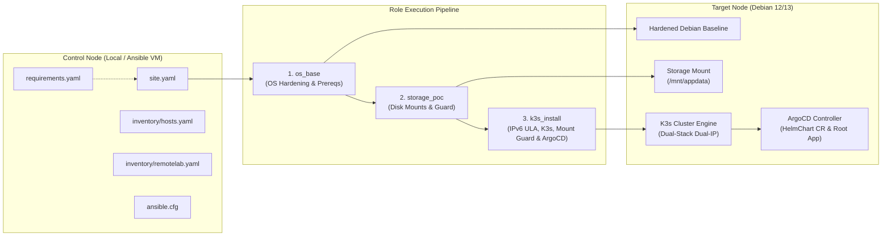

# Ansible Infrastructure & K3s Provisioning Documentation

This document describes the configuration management, OS hardening, storage provisioning, networking topology, and cluster bootstrapping implemented via **Ansible** (`ansible/`) for the K3s Homelab Migration project.

---

## 1. Orchestration Architecture & Workflow

The Ansible setup automates the **Day-1 provisioning** of target nodes, preparing a Debian system (tested on Debian 12/13) to serve as a dual-stack K3s Kubernetes host with an autonomous GitOps engine.



### Configuration & Inventory Structure

* **`requirements.yaml`:**
  * Declares external collection dependencies (`ansible.posix`, `community.general`) installed via `ansible-galaxy collection install -r requirements.yaml`.
* **`ansible.cfg`:**
  * `inventory = ./inventory/hosts.yaml`: Default inventory location.
  * `roles_path = ./roles`: Modular role directory.
  * `host_key_checking = False`: Prevents interactive SSH host-key prompts on freshly provisioned disposable instances.
  * `stdout_callback = debug`: Human-readable console output.
  * `pipelining = True`: Reuses SSH connections and executes Python tasks in memory to reduce network latency.
* **Inventories:**
  * **`inventory/hosts.yaml` (AWS Cloud PoC):** Routes SSH traffic via the dynamically generated OpenSSH configuration from Terraform (`ansible_ssh_common_args: '-F ../terraform/aws-poc/ssh_config'`). Defines `data_disk_device` using the persistent udev path `/dev/disk/by-id/nvme-Amazon_Elastic_Block_Store_<vol_id>` exported by Terraform.
  * **`inventory/remotelab.yaml` (RemoteLab Test VM):** Targets the local test node (`10.100.34.71`) as user `alex`, specifying a persistent SCSI WWID path (`/dev/disk/by-id/scsi-...`) for the storage disk.
* **Role Variable Architecture:**
  * Every role defines its parameters centrally in `roles/<role_name>/defaults/main.yaml`.
  * Values can be cleanly overridden per environment via inventory `group_vars/` or `host_vars/` without editing task files.
* **`site.yaml`:**
  * Root playbook applying the roles sequentially with elevated privileges (`become: true`):
    1. `os_base`
    2. `storage_poc`
    3. `k3s_install`

---

## 2. OS Baseline & Security Hardening (`roles/os_base`)

The `os_base` role establishes baseline hygiene, installs container storage prerequisites, and implements a security baseline tailored for Kubernetes host nodes.

### Package Management & Maintenance Updates
* **Base Packages (`os_base_packages`):** Default list installs `curl`, `git`, `htop`, `jq`, `open-iscsi`, `unattended-upgrades`, `apt-listchanges`, `systemd-timesyncd`, and `nfs-common` (required for K8s CSI persistent storage mounts).
* **Automated Security Updates (`unattended-upgrades`):**
  * Configured via `/etc/apt/apt.conf.d/50unattended-upgrades` to restrict automatic updates to security patches (`label=Debian-Security`).
  * Kernel images and headers (`linux-image*`, `linux-headers*`) are blacklisted from uncoordinated auto-reboots.
  * Configured with automatic reboot window scheduled via `os_reboot_time` (default: `"03:00"`).
  * Update schedules configured via `os_auto_clean_days` (default: `"7"`).
  * Verified active via systemd timers (`apt-daily.timer`, `apt-daily-upgrade.timer`).

### Persistent IPv6 ULA Configuration (ADR-0001)
* **Dynamic Network Framework Detection:**
  * Automatically detects whether the target host uses classic Debian `ifupdown` (`/etc/network/interfaces.d/`) or modern cloud `netplan` (`/etc/netplan/`).
  * Writes persistent configuration for `os_ipv6_ula` (default: `"fd85:cc6d:b16f:30::10/64"`):
    * Debian ISO / RemoteLab: `/etc/network/interfaces.d/60-ula.cfg`
    * Cloud AMIs / Netplan: `/etc/netplan/60-ula.yaml`
* **Non-Destructive Runtime Activation:**
  * Checks `ansible_facts['all_ipv6_addresses']` and applies the address via `ip -6 addr replace` if not present.
  * Refreshes Ansible network facts immediately after assignment.

### OpenSSH Daemon Hardening
* Deployed as a modular drop-in file at `/etc/ssh/sshd_config.d/00-hardening.conf` (mode `0644`, syntax-validated via `sshd -t -f %s`).
* **First-Match-Wins Precedence:** Uses the `00-` prefix to ensure rules evaluate before default settings.
* **Authentication Controls:**
  * `PermitRootLogin no`: Direct root logins prohibited.
  * `PasswordAuthentication no` & `KbdInteractiveAuthentication no`: Enforces key-based authentication (`PubkeyAuthentication yes`).
  * `AllowUsers {{ ansible_user }}`: Restricts SSH access to the configured administrative user.
* **Brute-Force & DoS Mitigation:**
  * `MaxAuthTries 3`: Terminates sessions after three failed attempts.
  * `LoginGraceTime 30`: Drops unauthenticated connections after 30 seconds.
* **Session Hygiene:**
  * `ClientAliveInterval 300` and `ClientAliveCountMax 2`: Terminates orphaned sessions after 10 minutes of inactivity.
  * `X11Forwarding no` and `AllowAgentForwarding no`: Prevents graphical forwarding and agent socket hijacking.
* Triggers handler `restart ssh` on changes.

### Kernel Sysctl Hardening & Tuning
* Maintained at `roles/os_base/files/99-kubernetes-hardening.conf` and copied to `/etc/sysctl.d/99-kubernetes-hardening.conf`. Reloaded via handler `sysctl --system`.
* **Anti-Spoofing & Network Protection (Kubernetes-Compatible):**
  * `net.ipv4.conf.all.rp_filter = 2` and `net.ipv4.conf.default.rp_filter = 2`: **Loose-Mode Reverse Path Filtering (ADR-0005)**. Prevents silent dropping of asymmetric container/Flannel CNI traffic.
  * Disables ICMP redirects (`accept_redirects = 0`, `send_redirects = 0`) and IP source routing (`accept_source_route = 0`).
  * Enables TCP SYN cookies (`net.ipv4.tcp_syncookies = 1`).
* **Routing Requirements:**
  * Enforces `net.ipv4.ip_forward = 1` and `net.ipv6.conf.all.forwarding = 1` required for pod overlay and ULA communication.
* **Kernel & Memory Protection:**
  * Restricts dmesg access (`kernel.dmesg_restrict = 1`), hides pointer addresses (`kernel.kptr_restrict = 2`), disables SysRq (`kernel.sysrq = 0`), and protects hardlinks/symlinks.
* **Container Workload Limits:**
  * Increases inotify limits (`fs.inotify.max_user_watches = 524288`, `fs.inotify.max_user_instances = 8192`) to prevent container crashes in file-monitoring tools.

### Journald Log Volume Limits
* Deployed to `/etc/systemd/journald.conf.d/00-limits.conf`.
* Configurable via role defaults: `os_systemd_max_usage: "1G"`, `os_systemd_max_file_size: "100M"`, `os_systemd_max_retention_sec: "1month"`.
* Prevents the host root filesystem from filling with logs, mitigating Kubernetes `DiskPressure` node taints and pod evictions. Triggers handler `restart systemd-journald`.

### Kernel Module Blacklisting
* Maintained at `roles/os_base/files/99-hardening-blacklist.conf` and copied to `/etc/modprobe.d/99-hardening-blacklist.conf`.
* Stubs out vulnerable or obsolete subsystems (`install <module> /bin/true`):
  * **Uncommon Network Protocols:** `dccp`, `rds`, `tipc`.
  * **Obsolete Filesystems:** `cramfs`, `freevxfs`, `jffs2`, `hfs`, `hfsplus`, `udf`.

### Sudoers Security & Non-Interactive Automation
* Deploys `/etc/sudoers.d/00-hardening` (`Defaults use_pty`, `Defaults logfile="/var/log/sudo.log"`).
* Deploys `/etc/sudoers.d/10-ansible` granting `{{ ansible_user }} ALL=(ALL) NOPASSWD: ALL` (mode `0440`, syntax-validated via `visudo -cf %s`), enabling non-interactive Ansible automation and CI/CD pipelines without plaintext passwords in runners.

---

## 3. Storage Provisioning (`roles/storage_poc`)

The `storage_poc` role prepares dedicated storage for Kubernetes persistent volumes by creating and mounting a data volume.

### Role Parameters (`defaults/main.yaml`)
* `storage_mount_point`: Destination directory on the host (default: `"/mnt/appdata"`).
* `storage_filesystem_type`: Target filesystem (default: `"ext4"`).
* `storage_volume_options`: Mount options (default: `"defaults,nofail"`).

### Implementation Workflow
1. **Pre-Flight Device Check (`assert`):**
   * Verifies that `data_disk_device` is defined in the active inventory, failing fast before performing disk operations.
2. **Filesystem Creation (`community.general.filesystem`):**
   * Idempotently formats `{{ data_disk_device }}` with `{{ storage_filesystem_type }}` if unformatted.
3. **Mount Point Provisioning (`file`):**
   * Ensures `{{ storage_mount_point }}` directory exists with permissions `0755`.
4. **Persistent Mounting (`ansible.posix.mount`):**
   * Mounts the device to `{{ storage_mount_point }}` and registers the entry in `/etc/fstab` with `opts: "{{ storage_volume_options }}"`.
   * The `nofail` flag ensures the host boots successfully into multi-user mode even if the storage volume is temporarily detached.

### Device Addressing in Inventories
Target hosts must reference stable udev paths rather than ephemeral kernel names (`/dev/sdb` or `/dev/nvme1n1`):
* **AWS Cloud PoC (Nitro NVMe):** Uses the udev path `/dev/disk/by-id/nvme-Amazon_Elastic_Block_Store_<vol_id>` exported by Terraform.
* **RemoteLab / Bare Metal:** Uses persistent SCSI WWID symlinks (`/dev/disk/by-id/scsi-...`) or filesystem UUIDs.

---

## 4. K3s Dual-Stack Networking (`roles/k3s_install`)

The `k3s_install` role configures and bootstraps K3s with native dual-stack networking according to ADR-0001.

### 1. ADR-0001 ULA Verification
Before configuring K3s, the role asserts that the host has a valid IPv6 ULA matching `k3s_node_ipv6_prefix` (default: derived dynamically from `os_ipv6_ula` or `"^fd85:cc6d:b16f:30::"`).

### 2. Root-Disk Overflow Guard
The role refreshes mount facts and verifies that `k3s_storage_path` (default: `"{{ storage_mount_point | default('/mnt/appdata') }}"`) is actively mounted in `ansible_facts['mounts']`. If unmounted, execution halts immediately to prevent K3s from writing persistent volumes to the host's root partition.

### 3. Declarative Configuration (`/etc/rancher/k3s/config.yaml`)
Node parameters are generated from role defaults before K3s runs:

```yaml
# Dual-Stack according to ADR-0001
cluster-cidr: "{{ k3s_cluster_cidr }}"       # default: "10.42.0.0/16,fd85:cc6d:b16f:4200::/56"
service-cidr: "{{ k3s_service_cidr }}"       # default: "10.43.0.0/16,fd85:cc6d:b16f:4300::/112"
flannel-ipv6-masq: true

# Force the node to use both IPs (dynamic IPv4 + static ULA)
node-ip: "{{ ansible_facts['default_ipv4']['address'] }},{{ ansible_facts['all_ipv6_addresses'] | select('match', k3s_node_ipv6_prefix) | first }}"

# Storage: Dedicated path for Persistent Volumes
default-local-storage-path: "{{ k3s_storage_path }}"

# Optional TLS Subject Alternative Names for remote kubectl (ADR-0007)
# tls-san: [...]
```

* **Storage Redirection (`default-local-storage-path`):** Redirects K3s's built-in `local-path-provisioner` to `{{ k3s_storage_path }}`.
* **TLS SAN Support (ADR-0007):** Supports adding public IPs or external hostnames via `k3s_tls_san` for secure remote API access.
* **Restart Handler:** Any modification to `config.yaml` automatically notifies the `Restart k3s` handler.

---

## 5. K3s Lifecycle & GitOps Bootstrap Engine (`roles/k3s_install`)

The role bootstraps the K3s engine and ArgoCD using a dual-track strategy (ADR-0006) to decouple controller installation from application delivery:

1. **Manifest Directory Provisioning:** Creates `/var/lib/rancher/k3s/server/manifests` (mode `0700`, `root:root`).
2. **Declarative ArgoCD HelmChart (`argocd.yaml`):** Deploys a K3s `HelmChart` custom resource into the auto-deploy directory:
   * Chart version is pinned (`argocd_chart_version: "7.7.16"` in `defaults/main.yaml`).
   * Automatically manages the `argocd` namespace (`targetNamespace: argocd`, `createNamespace: true`).
3. **Versioned K3s Installation & Upgrades:**
   * Checks currently installed version via `k3s --version`.
   * Executes `/tmp/k3s-install.sh` with `INSTALL_K3S_VERSION: "{{ k3s_version }}"` (default: `"v1.37.1+k3s1"`) only if uninstalled or version differs.
4. **CRD Establishment Wait:**
   * Polls `crd/applications.argoproj.io` until established, using configurable timings (`k3s_argocd_wait_retries: 24`, `k3s_argocd_wait_delay: 5`).
5. **Decoupled App-of-Apps Root Application:**
   * Applies `k8s/bootstrap/root-app.yaml` via `k3s kubectl apply`.
   * **Dual-Reconciler Prevention (ADR-0006):** Placed outside K3s's auto-deploy directory so that only ArgoCD reconciles application manifests without competing against K3s's filesystem watcher.

---

## 6. Execution Guide & Verification

### Running the Playbook

```bash
# 0. Install external collection dependencies
ansible-galaxy collection install -r requirements.yaml

# 1. Syntax check
ansible-playbook -i inventory/remotelab.yaml site.yaml --syntax-check

# 2. Dry run / Check mode
ansible-playbook -i inventory/remotelab.yaml site.yaml --check

# 3. Apply infrastructure state
ansible-playbook -i inventory/remotelab.yaml site.yaml
```

### Post-Deployment Verification Checklist

After applying the playbook or performing a cold reboot, verify system integrity on the target node:

```bash
# 1. Verify storage mount persistence
findmnt /mnt/appdata

# 2. Verify kernel hardening parameters
sysctl kernel.dmesg_restrict kernel.sysrq net.ipv4.conf.all.rp_filter

# 3. Verify active systemd timers & time synchronization
systemctl is-active systemd-timesyncd apt-daily.timer apt-daily-upgrade.timer

# 4. Verify modprobe stub execution
sudo modprobe -n -v dccp
# Expected output: install /bin/true

# 5. Verify journald disk usage limit
journalctl --disk-usage

# 6. Verify K3s node and pod status
sudo k3s kubectl get nodes -o wide
sudo k3s kubectl get pods -A
```
